# Learn2Unlock — Demo & Presenter Guide

> **Learn a little. Unlock a little.**
> Kids earn screen time by answering short, school-curriculum quiz questions. Parents set the rules, and AI helps parents write questions — but **a parent must approve every AI question before a child ever sees it.**

This README is everything you need to run the app and present it. Read it top to bottom once, do the **rehearsal** in section 3, then **reset** (section 3.4) before you go on stage.

---

## Contents

1. [The 30-second pitch](#1-the-30-second-pitch)
2. [One-time setup (do this the day before)](#2-one-time-setup-do-this-the-day-before)
3. [Starting the demo on presentation day](#3-starting-the-demo-on-presentation-day)
4. [Demo script (≈ 7 minutes)](#4-demo-script--7-minutes)
5. [Screen-by-screen walkthrough + presenter notes](#5-screen-by-screen-walkthrough--presenter-notes)
6. [Likely judge questions](#6-likely-judge-questions)
7. [What is real vs. simulated (be honest about this)](#7-what-is-real-vs-simulated-be-honest-about-this)
8. [Troubleshooting](#8-troubleshooting)
9. [For developers](#9-for-developers)

---

## 1. The 30-second pitch

**Problem.** Parental-control apps only *block* — timers and lockouts. That turns parents into the bad guy, causes daily arguments, and the child learns nothing. "Answer-a-question-to-unlock" apps exist, but their questions don't match the Malaysian school syllabus, parents don't have time to write their own, and parents don't trust AI-written questions they can't check.

**Our solution.** Learn2Unlock is **two apps + a server**:

| Part | Who uses it | What it does |
|---|---|---|
| **Parent app** (dark navy) | Mum / Dad | Set screen-time rules, approve time requests, manage the question bank, generate questions with AI and review them |
| **Child app** (warm cream, with Milo the otter mascot) | The child | Sees remaining play time; when time runs out, takes a 5-question challenge to earn more |
| **API server** | Runs on the laptop | Stores everything, **scores the quiz**, awards minutes, enforces the rules |

**The key idea (say this clearly):** the AI is only a *drafting assistant*. AI questions start as "pending review", a safety filter throws out bad ones automatically, and a parent approves the rest. **The AI can never score a quiz, change a rule, or give a single minute of screen time** — that's all done by normal, predictable server code.

Questions are tagged to **KSSR** (Malaysia's primary-school curriculum), Years 1–6, in **Mathematics, Science, Bahasa Melayu and English**.

---

## 2. One-time setup (do this the day before)

You need a Windows or Mac laptop with internet. Allow ~15 minutes.

### 2.1 Install the tools

1. **Node.js 22** — download the "LTS" installer from <https://nodejs.org> and install it (keep all default options).
2. **Git** — <https://git-scm.com/downloads> (default options).
3. Open a terminal (Windows: search **PowerShell**; Mac: **Terminal**) and turn on pnpm (the package manager this project uses):

```bash
corepack enable
```

> If that says "permission denied" on Windows, open PowerShell with **Run as administrator** and run it again. Alternative: `npm install -g pnpm@11.9.0`.

### 2.2 Download the project

```bash
git clone https://github.com/sadad54/Learn2Unlock.git
```

```bash
cd Learn2Unlock
```

```bash
pnpm install
```

`pnpm install` takes a few minutes the first time. Warnings are normal; it's fine as long as it ends without a red `ERR`.

### 2.3 Add the AI key

The AI question generator needs a **Groq API key**. **Adnan will send you this key privately** (do not post it anywhere, do not commit it to GitHub).

1. In the `apps/api-server` folder, make a copy of `.env.example` and name the copy `.env`
   - Windows PowerShell: `copy apps\api-server\.env.example apps\api-server\.env`
   - Mac: `cp apps/api-server/.env.example apps/api-server/.env`
2. Open `apps/api-server/.env` in Notepad / any text editor and replace this line:

```dotenv
GROQ_API_KEY=gsk_REPLACE_WITH_YOUR_GROQ_API_KEY
```

with the key Adnan sent you (it starts with `gsk_`). Save the file.

> Without the key, **everything works except the "Generate with AI" button** (it shows an error asking for the key).

### 2.4 Quick check

```bash
pnpm test
```

You should see `# pass 3` and `# fail 0`.

---

## 3. Starting the demo on presentation day

You will use **two terminal windows** so the parent app and child app can be open at the same time in two browser tabs.

### 3.1 Terminal 1 — server + parent app

```bash
pnpm parent:web
```

Wait until you see `Logs for your project will appear below`. Open **<http://localhost:8081>** in Chrome → this is the **parent app**.

### 3.2 Terminal 2 — child app

Open a second terminal, `cd` into the `Learn2Unlock` folder again, then:

```bash
pnpm child:web:8082
```

Open **<http://localhost:8082>** in a second Chrome tab → this is the **child app**.

### 3.3 Make it look like a phone (recommended)

In each Chrome tab press **F12** → click the **phone/tablet icon** (Toggle device toolbar, or `Ctrl+Shift+M`) → choose **iPhone 12 Pro** or similar from the dropdown at the top. Close the side panel if it's in the way. Now both apps look like real phone screens. Zoom the browser (`Ctrl` + `+`) so the audience can read it.

**Log-in details** (already pre-filled on the sign-in screen):

| | |
|---|---|
| Parent email | `parent@example.com` |
| Parent password | `password` |
| Child | no login needed — the child app pairs automatically (pairing code `482 715`) |

### 3.4 ⚠️ Reset before you present (important!)

The server enforces real rules, and they will bite you if you rehearse:

- The child can only start **2 challenges per day**. A 3rd attempt shows *"Daily challenge attempt limit reached."*
- The child can earn at most **30 bonus minutes per day**.
- Requests you approve during rehearsal stay approved.

**To reset everything back to fresh demo data:**

1. Stop both terminals (click in each and press `Ctrl+C`; answer `Y` if asked).
2. Delete this one file: `apps/api-server/data/learn2unlock.sqlite`
3. Start again (section 3.1 and 3.2). The server recreates the file with fresh demo data.

Also, in each browser tab do a hard refresh (`Ctrl+Shift+R`).

**Recommended routine:** rehearse the full demo once → reset → don't touch the child challenge again until you're on stage. That gives you 2 live attempts on stage (one to pass, one spare).

---

## 4. Demo script (≈ 7 minutes)

Have both tabs open, both on their first screen. **Start with the child tab**, then switch to the parent.

> Why child first? The parent app loads the latest requests when the parent **signs in**. Doing the child part first means the request the child sends is waiting on the parent's dashboard.

| # | Time | Where | What you do | What you say (short version) |
|---|---|---|---|---|
| 1 | 0:00 | — | Talk | The 30-second pitch from section 1 |
| 2 | 0:30 | **Child** | Home screen | "Meet Aina, she's 10. This is her phone. She can see exactly how much play time she has left." |
| 3 | 0:50 | Child | **Earn more time** → read the card → **Start challenge** | "When her game time runs out, instead of a locked screen and an argument, she gets an offer: answer 5 questions, get 80%, earn 10 minutes." |
| 4 | 1:10 | Child | Answer all 5 correctly (answers below) → **Finish challenge** | "These are Year 4 Science questions from the Malaysian syllabus. The answers go to our server, which marks them, so the phone can't fake a pass." |
| 5 | 2:00 | Child | Result → **Use my play time** (point at the minutes: +10) | "She passed and earned 10 minutes. She learned something and nobody had to argue." |
| 6 | 2:20 | Child | **Ask parent** → keep "I'd like more time" → **Send to parent**. Then go back to the child Home (back arrow, or reload <http://localhost:8082>) and tap **Emergency and school apps** at the bottom | "If she needs more, she asks politely. And phone, school apps and emergency calls are never blocked." |
| 7 | 2:50 | **Parent** | Splash → **Open parent app** → **Sign in** | "Now the parent's side — a separate app with its own login." |
| 8 | 3:10 | Parent | Steps 1–5 of setup — click through quickly, tap one or two options (e.g. + on the daily limit), then **Finish setup** | "Parents set this up once, in under a minute: child profile, pair the phone, choose which apps to limit, daily limits and bedtime, and reward rules with a daily cap." |
| 9 | 4:20 | Parent | **Dashboard** → Aina's **time request** card → **Approve** | "Here's Aina's request. Mum decides — approve, or not now. There's also a Pause button for dinner time." |
| 10 | 4:50 | Parent | **Questions** tab → point at a KSSR code → **Generate questions with AI** → **Generate 5 questions** (wait ~10 s) → **Approve** one, **Discard** one | "This is our key innovation. AI drafts syllabus questions so parents don't have to write them — but every single one waits for the parent's approval, and a safety filter has already removed bad ones. The AI never touches scores or screen time." |
| 11 | 6:15 | Parent | **Reports** tab → tap **Learning** | "Parents see screen time and learning progress side by side." |
| 12 | 6:40 | — | Wrap up | "Learn2Unlock turns screen time from a fight into a reward for learning — with the parent always in control of the AI." |

**Correct answers for the child challenge** (default demo questions, in order):

1. Which material is best for a raincoat? → **Waterproof plastic**
2. Plants make food mainly in which part? → **Leaves**
3. Which organ pumps blood around the body? → **Heart**
4. What happens to water when it freezes? → **It becomes solid**
5. Which force pulls objects toward Earth? → **Gravity**

> Tip: if you want to show the "fail" path too, answer 2 wrong — the child sees an encouraging "You're still learning!" message and the correct answer with an explanation. But remember: that uses one of the 2 daily attempts.

---

## 5. Screen-by-screen walkthrough + presenter notes

### Parent app (dark navy theme)

| Screen | What it does | Presenter notes |
|---|---|---|
| 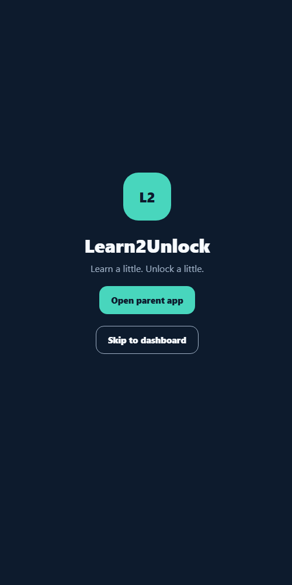 **Splash** | Entry screen. **Open parent app** → sign-in. **Skip to dashboard** jumps straight to the dashboard (handy backup if sign-in has a problem). | "Learn a little, unlock a little" — that's the whole idea in five words. |
| 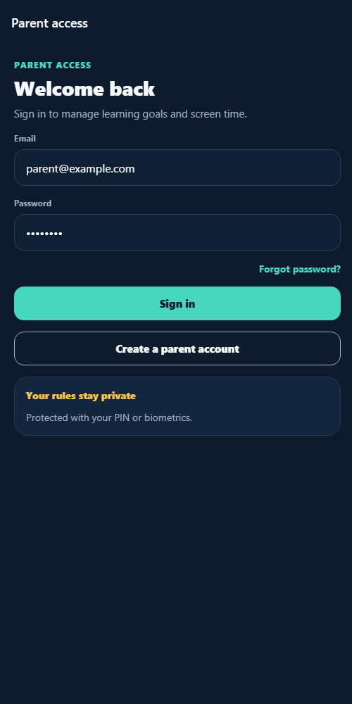 **Sign in** | Parent logs in (details pre-filled). **Create a parent account** registers a new parent on the server. | Parents and children have *separate* apps and separate logins — not one app with a hidden settings PIN. A child can't just open the parent settings. |
| 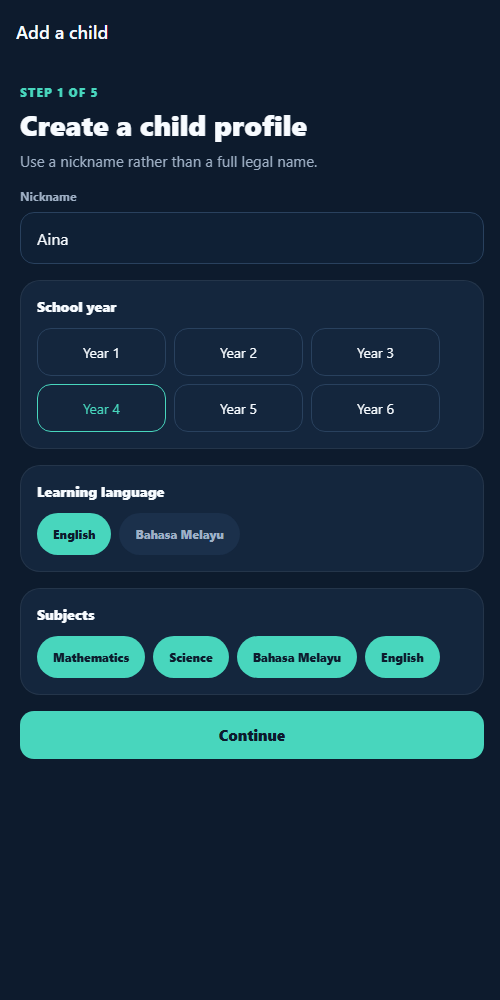 **Step 1 — Child profile** | Nickname, school year (1–6), learning language (English / Bahasa Melayu), subjects. | We ask for a **nickname, not a full name** — privacy by design for children's data. School year + subjects decide which curriculum questions are used. |
| 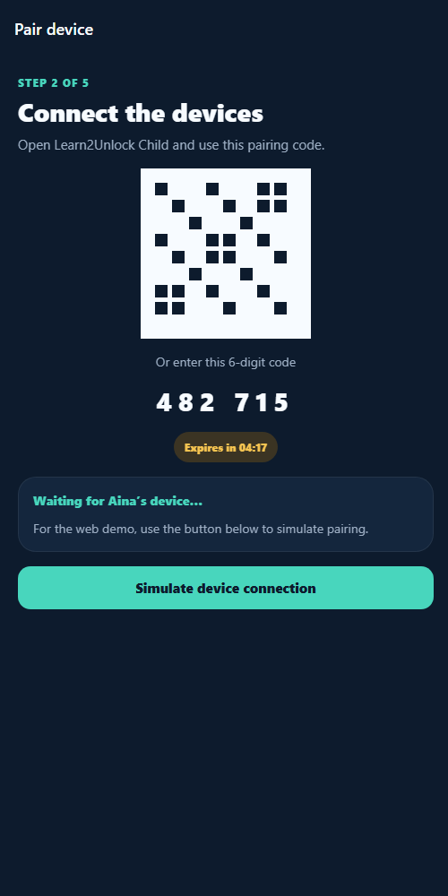 **Step 2 — Pair device** | Shows a QR code and 6-digit code (482 715) to link the child's phone. Click **Simulate device connection** for the demo. | In the real product the child's phone scans this. For the demo we simulate the pairing. |
| 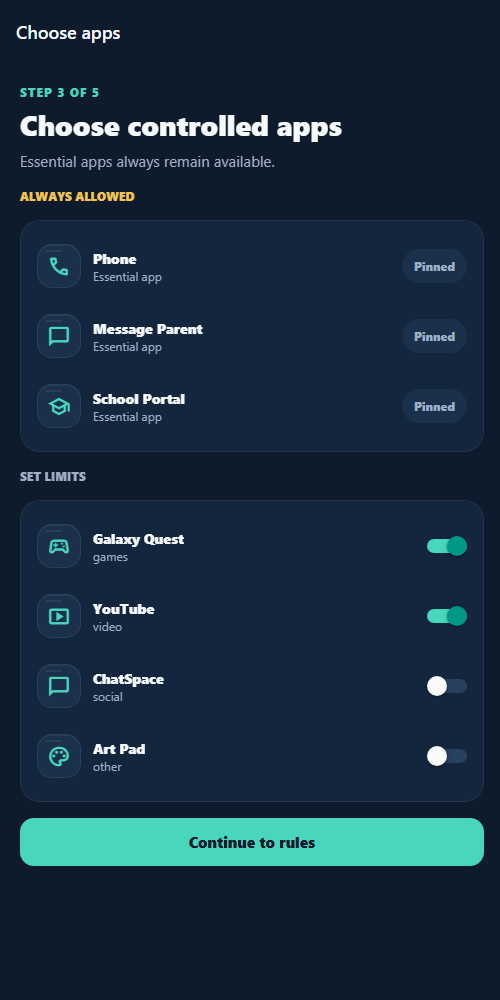 **Step 3 — Choose apps** | Top: **always-allowed** apps (Phone, Message Parent, School Portal) — can't be blocked. Bottom: toggle which apps get time limits (games, YouTube, chat…). | **Safety point:** a child can *always* call or message a parent, even with zero play time left. |
| 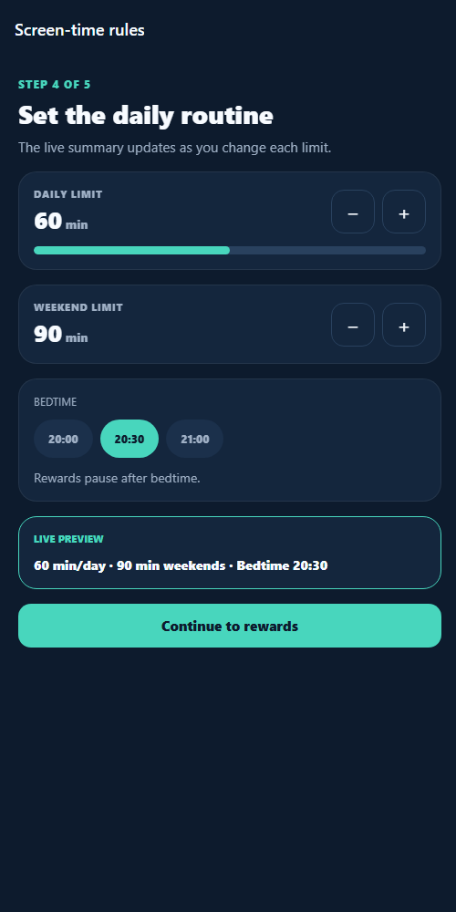 **Step 4 — Daily routine** | Daily limit, weekend limit (± buttons), bedtime. **Live preview** card updates as you change things. | Tap + on the daily limit to show the live preview updating. Rewards pause after bedtime — learning can't be used to stay up late. |
| 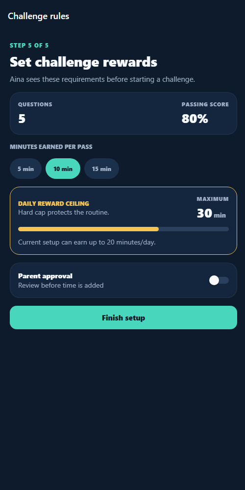 **Step 5 — Challenge rewards** | 5 questions, 80% to pass. Choose 5/10/15 minutes per pass. **Daily reward ceiling** (30 min) caps the bonus. Optional **Parent approval** switch. **Finish setup** saves everything to the server. | The cap stops a child "grinding" quizzes for unlimited time. With approval on, earned time waits for the parent's OK. |
| 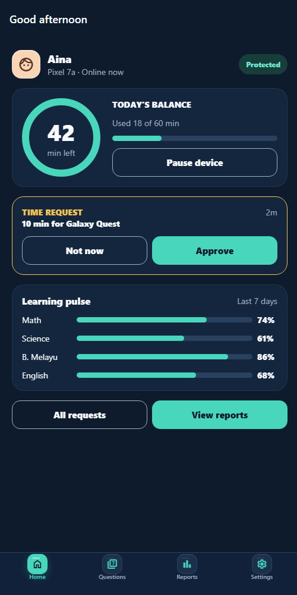 **Dashboard (Home tab)** | Time left today, **Pause device** button, latest **time request** (Approve / Not now), **Learning pulse** per subject, shortcuts to requests & reports. | This is the "glance" screen for a busy parent. **Pause device** is the instant "dinner time" button. |
| 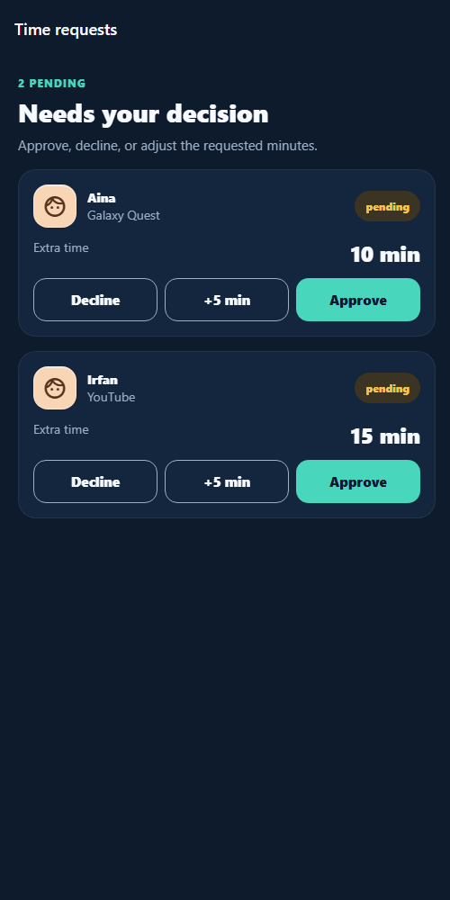 **Time requests** | All requests from children. **Decline**, **+5 min** (approve with extra), or **Approve**. | Shows multiple children (Aina and Irfan) — the product supports families with more than one child. |
| 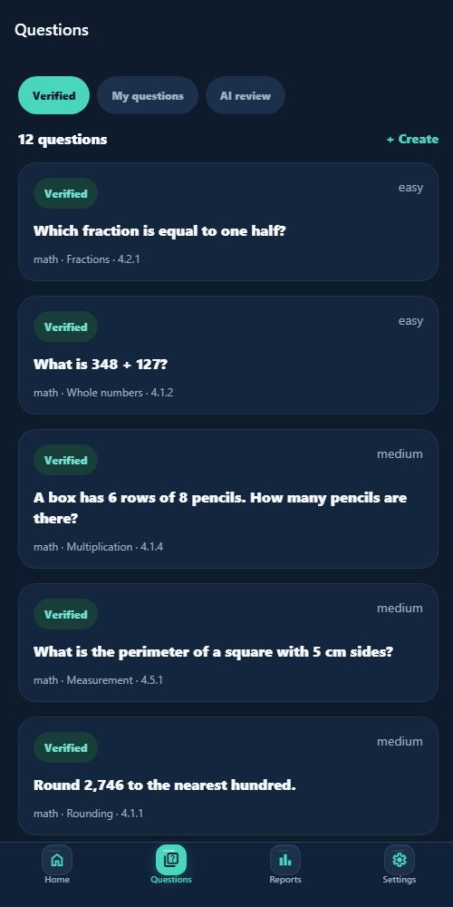 **Questions tab** | The question bank, filtered by **Verified** (built-in, curriculum-checked), **My questions** (parent-written), **AI review** (AI drafts waiting). Each card shows subject · topic · **KSSR code** (e.g. 4.2.1) and difficulty. **+ Create** to write one. | Point at the KSSR code: "every question is traceable to what the child is learning in school." |
| 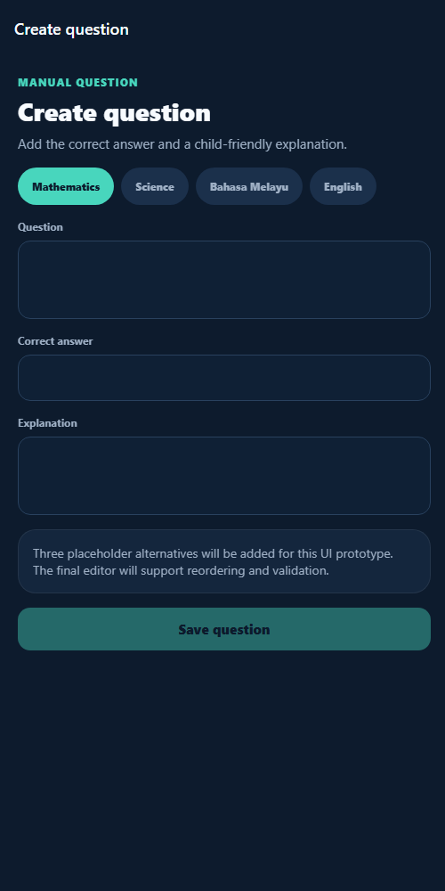 **Create question** | Parent writes their own question: subject, question, correct answer, explanation. | Explanations matter — when a child gets it wrong, they see *why*. |
| 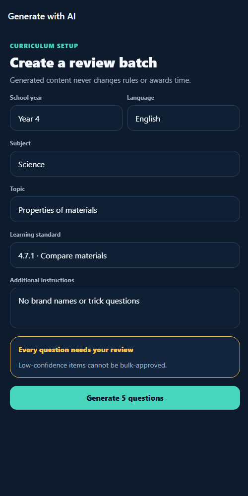 **Generate with AI** | Topic + extra instructions (e.g. "No brand names or trick questions"). **Generate 5 questions** (takes ~5–10 s). | "Generated content never changes rules or awards time" — it's written right on the screen. |
| 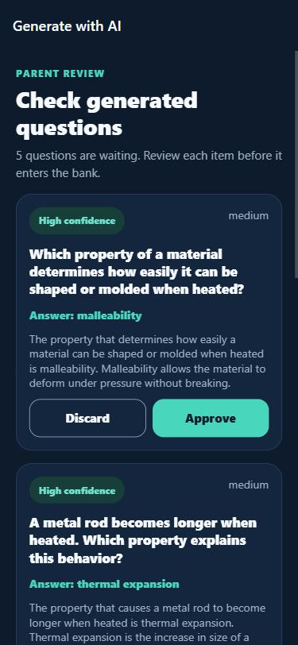 **AI review** | Each AI draft shows the question, answer, explanation and a confidence tag. Parent taps **Approve** (goes into the bank) or **Discard**. | **The most important screen.** Before the parent sees anything, the server already auto-rejected drafts that are unsafe, duplicated, have a wrong/missing answer, or a mismatched explanation. The parent only spends time on judgement. |
| 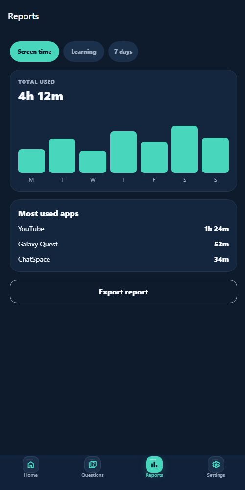 **Reports tab** | **Screen time**: weekly bar chart and most-used apps. **Learning**: accuracy by subject and challenge history. | Shows the parent the trade they're making: screen time ↔ learning. |
| 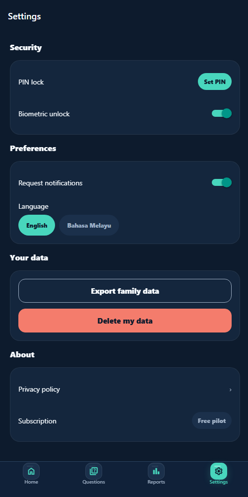 **Settings tab** | PIN / biometric lock, notifications, language, export/delete family data, privacy policy. | Data rights (export / delete) are built in from the start. |

### Child app (warm, friendly theme)

| Screen | What it does | Presenter notes |
|---|---|---|
| 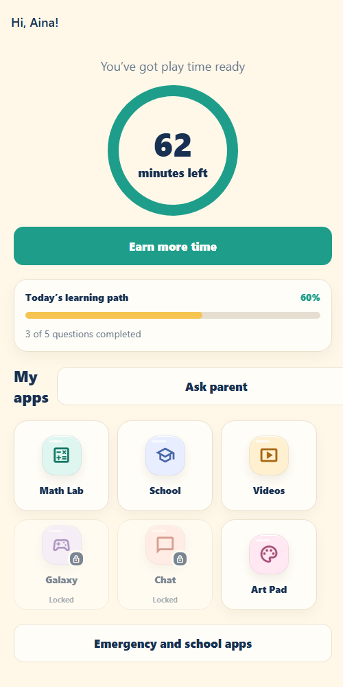 **Home** | Big ring with **minutes left**, **Earn more time** button, today's learning progress, the child's apps (locked ones show a padlock), **Ask parent**, **Emergency and school apps**. | Designed for a 7–12-year-old: big buttons, simple words, positive tone. |
| 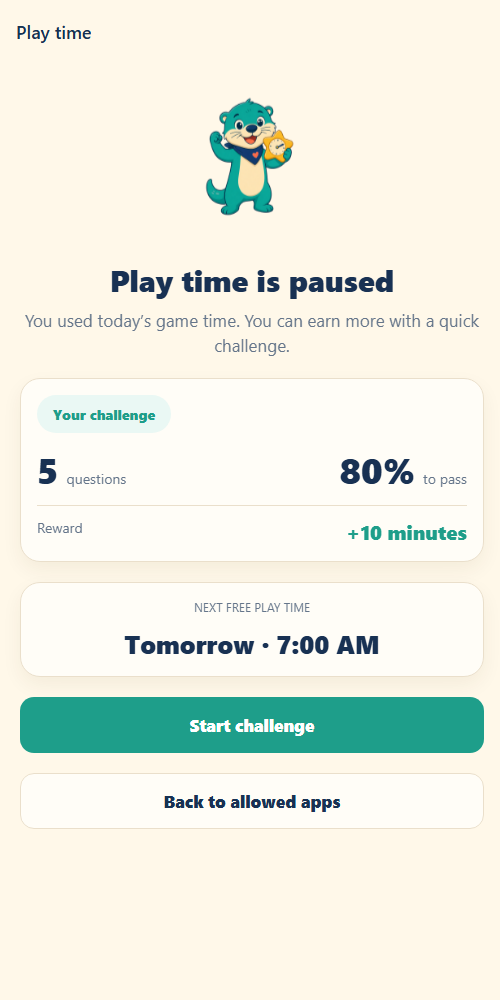 **Play time is paused** | What the child sees when time runs out. Shows the deal up front: 5 questions, 80% to pass, +10 minutes. **Start challenge**. | Milo the otter mascot keeps it encouraging — no "ACCESS DENIED" screens. The child knows exactly what's required *before* starting. |
| 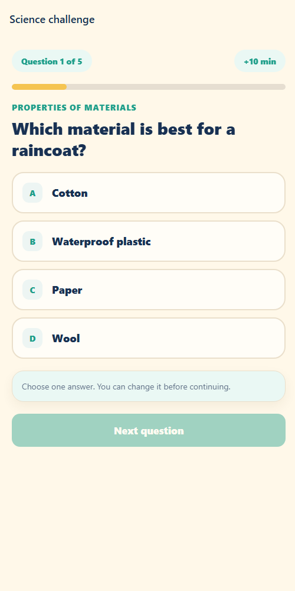 **Challenge** | 5 multiple-choice questions, one per screen, with a progress bar. Pick an answer → **Next question** → **Finish challenge**. | The answers are sent to the server, which does the scoring. The phone can't fake a pass. |
| **Result** (after finishing) | **Pass:** "Great thinking, Aina!", score, **+10 min** unlocked → **Use my play time** (balance goes up by 10). **Fail:** "You're still learning!", shows one correct answer with explanation → **Try again** or **Ask parent**. | Even failing teaches something — the child sees the right answer and why. |
| 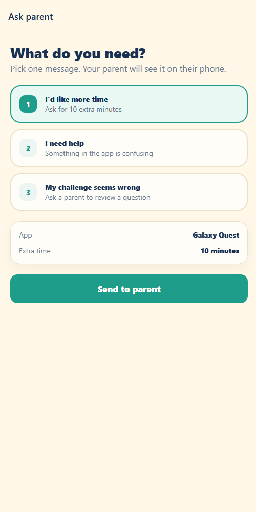 **Ask parent** | Pick a message: more time / I need help / my challenge seems wrong → **Send to parent**. It appears on the parent's Requests screen. | Replaces arguing with a polite, structured request. "My challenge seems wrong" lets kids flag bad questions — another human check on content. |
| 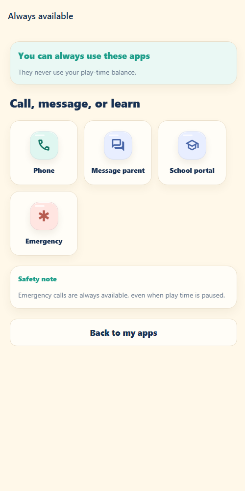 **Always available** | Phone, Message parent, School portal, Emergency — never blocked, never use play time. | Child safety comes first: emergency calls always work, even at 0 minutes. |

---

## 6. Likely judge questions

**"What stops the AI from showing something inappropriate to a child?"**
Three layers: (1) the AI must return a strict data format, so garbled output is rejected; (2) a server-side filter auto-rejects blocked words, duplicate options, answers that aren't among the options, explanations that don't match the answer, and repeats of existing questions; (3) a parent must approve each question. Only approved questions reach the child.

**"Can the AI give the child extra time?"**
No. Scoring, rewards and rules are plain server code. The AI's only job is to suggest question drafts.

**"Can the child cheat?"**
The phone only sends the chosen answers; the server checks them and awards minutes. A reward can only be granted once per challenge, there's a daily attempt limit and a daily minutes cap.

**"Which AI model?"**
An open-weight model (`openai/gpt-oss-20b`) served by Groq, which is very fast and cheap. The model can be swapped in config.

**"Is it aligned to the Malaysian curriculum?"**
Yes — every question carries a KSSR learning-standard code, subject, topic, year level and language (English or Bahasa Melayu).

**"What's built with?"**
React Native + Expo (one codebase for Android, iOS and web), TypeScript, a Node.js API server, SQLite database.

**"What's next?"**
Real device-level app blocking on Android, a pilot study with families measuring learning engagement and reduction in screen-time arguments, and growing the verified question bank.

---

## 7. What is real vs. simulated (be honest about this)

Judges respect honesty. This is a **working prototype**, not a store-ready product.

**Real (works end-to-end through the server):** parent sign-in/registration, saving the setup, the question bank, creating questions, AI generation + safety filter + approve/discard, child challenge scoring, minutes being added to the balance, daily limits on attempts and rewards, time requests and approving them.

**Simulated / sample data for the demo:**
- Device pairing (the **Simulate device connection** button) and the "Pixel 7a · Online now" label.
- The app doesn't actually block other apps on the phone yet — that needs native Android permissions (next phase).
- Dashboard numbers like "Used 18 of 60 min" and the **Learning pulse** percentages, and everything on the **Reports** tab, are sample numbers.
- Settings toggles, Export, Delete data and Forgot password are UI only.

If asked, say: *"The core loop — rules, AI drafting with parent review, server-side scoring and rewards — is fully working. Device-level blocking and real usage analytics are the next phase."*

---

## 8. Troubleshooting

| Problem | Fix |
|---|---|
| `pnpm` is not recognized | Run `corepack enable` (as administrator on Windows), or `npm install -g pnpm@11.9.0`, then open a new terminal. |
| `node` is not recognized | Install Node.js 22 LTS from nodejs.org, then open a **new** terminal. |
| Child app says **"Daily challenge attempt limit reached."** | You used up the 2 daily attempts. Do the **reset** in section 3.4. |
| Passed the challenge but minutes didn't go up | You hit the 30-minute daily cap. Reset (section 3.4). |
| **Generate with AI** shows "Groq is not configured…" | The key isn't in `apps/api-server/.env` (section 2.3). After editing `.env`, stop and restart Terminal 1. |
| **Generate with AI** shows "fetch failed" | Usually a brief network hiccup. Just press **Generate 5 questions** again. Check the venue Wi-Fi works. If there's no internet at all, skip this step and show the **AI review** screenshot in this README instead. |
| Screens show errors / won't load data | Terminal 1 must be running. Check <http://localhost:4000/health> shows `"status":"ok"`. |
| "Port 8081 / 8082 / 4000 is in use" | Something is still running from before. Close all terminals, open fresh ones and start again (or restart the laptop). |
| A screen looks stuck | Hard refresh the tab: `Ctrl+Shift+R`. |
| Something breaks live on stage | Stay calm: refresh the tab, or use **Skip to dashboard** on the parent splash. As a last resort, present from the screenshots in section 5. |

**Backup plan:** before the event, take your own screenshots/screen recording of the full demo on the laptop you'll use. If the Wi-Fi or laptop fails, present from those.

---

## 9. For developers

Expo (React Native) monorepo managed with pnpm workspaces.

```
apps/
  api-server/   Node.js HTTP API + SQLite (auth, rules, scoring, rewards, Groq AI drafts)
  parent-app/   Expo Router app for parents
  child-app/    Expo Router app for children
packages/
  shared/       Theme tokens, zod schemas, API client, KSSR seed questions
design-references/   UI mock-ups (open index.html)
docs/screenshots/    Screenshots used in this README
```

| Command | What it does |
|---|---|
| `pnpm parent:web` / `pnpm child:web` | API + parent / child app in the browser (port 8081) |
| `pnpm child:web:8082` | Child app only, on port 8082 (use alongside `pnpm parent:web`) |
| `pnpm parent` / `pnpm child` | API + app for **Expo Go** on a real phone (same Wi-Fi; scan the QR code) |
| `pnpm api` | API only (port 4000, health check at `/health`) |
| `pnpm typecheck` / `pnpm test` | Type checks / tests |

- Config lives in `apps/api-server/.env` (copy from `.env.example`). The Groq key stays on the server and is never bundled into the apps.
- The local database is `apps/api-server/data/learn2unlock.sqlite` (git-ignored); deleting it reseeds demo data on next start.
- On a real phone with Expo Go, the apps automatically point at the laptop's LAN address for the API. If Windows asks, allow Node.js on private networks, and allow inbound TCP port 4000 in the firewall.
